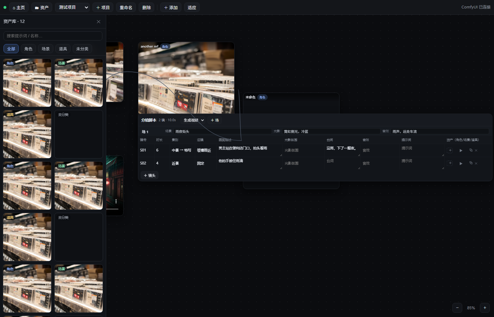

# 2026-10-29 上午 · 资产库改造 + 脚本长文本

## 1. 资产库重做

| 改动 | 说明 |
|---|---|
| **搜索框** | 按提示词 / 名称模糊过滤 |
| **分类 chip** | `全部 / 角色 / 场景 / 道具 / 未分类`（5 个） |
| **分类角标** | 每个缩略图左上角显示分类，颜色区分（角色蓝 / 场景绿 / 道具黄 / 未分类灰） |
| **布局修复** | 真正的两列网格 + 纵向滚动（`min-height:0`），资产多了不再叠在一起 |
| **抽屉加宽** | 288 → 300px |

**分类怎么来**

- 画布上图片/视频节点有 `role`（点卡片名字旁边的标签切换：角色 → 场景 → 道具）；
- `asset.list` 会按 `file` 反查画布节点，把 role 带到资产上（**老资产自动补分类**）；
- 没有 role 的 → 显示「未分类」，可在画布上给那张卡点标签补上。

**DOM 测试**：`assets=12, chips=5, search=1` ✅

## 2. 脚本表长文本

- 「画面描述 / 台词 / 提示词」三列从单行 `input` 换成**自动增高的 textarea**；
- 高度按内容长度自动算（2–6 行）；
- 短字段（镜号/时长/景别/运镜/音效/光影）仍是单行输入，保持紧凑。

**DOM 测试**：`areas=6`（3 列 × 2 行）✅

## 3. 仍未处理

- 多窗口并发编辑（今天先不管）
- 拼接产物 fragmented mp4 封装
- 参考图超 4 张静默丢弃
