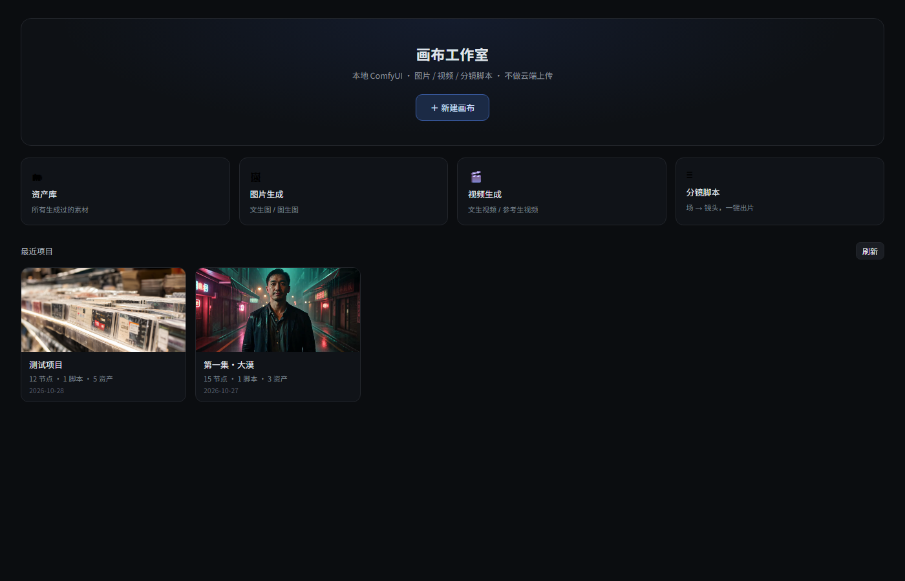

# 主页 + 缺陷分析（2026-10-29 凌晨）

## 一、新增：主页

**结构**

1. **Hero**：`＋ 新建画布`
2. **四个快捷入口**
   - 资产库：打开最近项目并自动展开资产抽屉
   - 图片生成：打开/新建项目 → 直接落一张空图片卡
   - 视频生成：同上，落视频卡
   - 分镜脚本：同上，落脚本卡
3. **最近项目网格**：缩略图（取项目里第一张图/视频）+ 名称 + `N 节点 · N 脚本 · N 资产` + 日期

**数据来源**：`project.list` 现在额外返回 `nodes / images / videos / scripts / assets / thumb / thumbKind`（宿主读取每个项目的 canvas.json 与 assets/index.json）。

**导航**：画布顶部新增 `⌂ 主页`；点项目卡片进入画布（DOM 测试：`canvas=1, home=0`）。

---

## 二、本轮修掉的 bug

| # | Bug | 影响 | 修法 |
|---|---|---|---|
| 1 | 生成失败/取消后卡片一直显示「生成中…」 | 卡片永远转圈，无法重新生成 | 轮询拿到 `failed/canceled` 时把状态写回 `failed/idle` |
| 2 | 每 3 秒的画布同步会覆盖正在编辑的单元格 | 正在打字的文字被抹掉 | 焦点在 input/textarea 时跳过本轮轮询 |
| 3 | 主页快捷入口建完节点不选中 | 建了卡还要自己点一下 | 建完自动选中并打开浮层 |

---

## 三、还缺的 bug / 体验问题（按优先级）

### P0（影响正确性）

1. **多窗口同时编辑会丢更新**
   现在只有 `rev` 冲突重试（last-write-wins）。两个窗口同时改不同卡片，后保存的会盖掉前一个。
   建议：保存时按节点 id 做字段级合并（只合并本次真正改过的节点）。

2. **拼接产物是 fragmented mp4**
   浏览器能播，但 QuickTime / 部分剪辑软件会拒绝。
   建议：拼接后跑一次 `-c copy -movflags +faststart` 的二次封装（需要写临时文件 → 用当前管道方案再包一层 mdat 重排）。

3. **超过 4 张参考图被静默截断**
   绑定第 5 张时不报错、直接丢。
   建议：绑定时提示「H3 最多 4 张，已忽略第 5 张」。

### P1（体验）

4. 脚本表长文本用单行 input（画面描述/提示词应换 textarea + 自适应高度）
5. 脚本卡没有最大高度，场多了要滚整块画布（应卡片内滚动）
6. 资产库没有搜索，只能按类型筛
7. 节点宽度固定 320，不能缩放（长提示词卡片看不清）
8. 生成失败没有「重试」按钮（要点两次）
9. 字幕开关不记忆，换节点回到关闭
10. 删除项目没有回收站
11. 主页缩略图取「第一个有文件的节点」，该节点被删就变空
12. 资产库不显示生成耗时/成本（assets 里其实有 `durationMs`）

### P2（能力）

13. 没有「整表批量生成」：`run=true` 只跑当次那一行，跑整表要循环调用
14. 没有 AI 拆镜（一段中文 → 自动成镜头行）
15. 没有逐镜超分 2K/4K
16. 没有竖屏 9:16 一键重出
17. 没有导出/下载成片按钮（现在只能通过 `cnv_concat` 落节点）

---

## 四、作为插件本身的问题

1. **单文件过大**：`lib/index.js` 约 1500 行、`lib/client.js` 约 2600 行，全部手写 `h()`，无类型、无测试。
   → 建议拆成 `canvas.js / jobs.js / script.js / tools.js` 四个模块。

2. **工具 schema 坑**
   `defineTool` 对 `object` 参数要求显式 `additionalProperties`，踩过两次（一次整个 registerTools 静默失败，工具全不注册）。
   → 建议加一条启动自检：注册后立即校验工具数量，失败就写 probe 日志。

3. **没有版本兼容声明**
   `package.json` 里没有 `dsh.engines`，DSH 升级后接口变动会直接坏。

4. **没有使用文档**
   只有 `docs/PRD.md`（设计），缺 README（怎么装、怎么用、工具有哪些）。

5. **子进程写文件受限**
   本机环境下 ffmpeg 无法直接写 `~/.dsh/projects`，只能走 stdout 管道 + Node 落盘。
   → 这是环境特性，已在代码里处理并在注释里写明原因。

6. **客户端 HMR 依赖刷新**
   改 UI 要 F5，改宿主必须重启（已在顶栏提示）。
